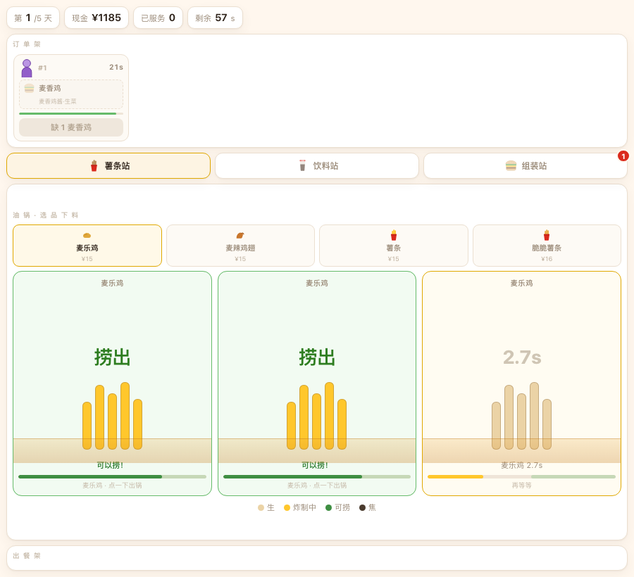
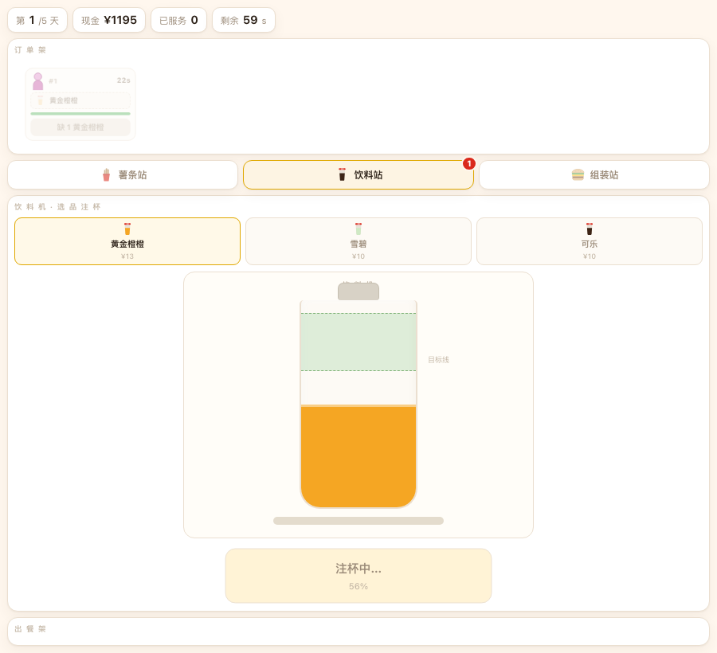

# 麦麦大亨 · 后厨

> 一个用**真实麦当劳菜单**做的后厨做菜游戏。薯条要盯着油锅捞，可乐要按住按钮打到线上，汉堡要照着票子一层一层加料。
> 参赛项目 · 麦当劳程序员节创意开发大赛 · **非麦当劳官方产品**



---

## 这是什么

大部分"餐饮经营"游戏，你其实是个经理：看报表、调价格、点按钮。后厨那一摊事被一个进度条糊弄过去了。

这个反过来——**你就是那个站在后厨的人**：

- 订单从门口挂上来，一张一张排在顶部的票架上
- 三座工位，一屏只站一个，靠 tab 切：薯条站 / 饮料站 / 组装站
- 每一份都得你亲手做出来，做得准不准，直接决定小费和废品率
- 顾客有耐心条，耗完了就走人，钱和口碑一起没

一天 60 秒，经营 5 天。从 ¥1200 起步，房租每天 ¥40，最后按现金余额评 S / A / B / C / D。

**菜单、价格、汉堡配方、营养数据全部来自麦当劳 MCP 实时拉取**——这家店今天卖什么，游戏里就卖什么。换一家店、换一天，内容都不一样。

---

## 在线试玩

直接开：**[rockeyld.github.io/mcd-mogul](https://rockeyld.github.io/mcd-mogul/)**

不用装东西、不用申请 Token、不用登录。手机打开也能玩（窄屏会自动重排）。

---

## 怎么玩

### 一张单的完整流程

```
看票  →  切到对应工位  →  选品  →  制作  →  成品落到出餐架  →  点订单上的「出餐」
```

出餐架是三个工位共用的，9 格，满了就放不下。哪张单凑齐了，点哪张。

### 三座工位

| 工位 | 你要做的 | 怎么搞砸 |
|---|---|---|
| **薯条站** | 3 个油槽各自计时。进度条进绿区，点一下捞出 | 没炸透就捞＝扔了；过了头就焦，得再点一下清锅 |
| **饮料站** | 按住杯子注液体，液面进绿区松手 | 没到线下＝倒了；超过上线＝溢了。都算废品 |
| **组装站** | 照着票面顺序逐层点配料，加满合上出餐 | 顺序错了抖一下，连错 3 次这份废掉 |



### 压力从哪来

- 三个油锅同时在走，但你一屏只能看一个工位
- 薯条熟成窗口 3.8 秒，绿区只占 45%
- 顾客耐心从第 1 天的 22 秒缩到第 5 天的 15 秒
- 出餐架只有 9 格——做多了没地方放

### 评分

绿区正中出品 = 完美，小费 +20%；偏一点 = 良好，+10%。废品会真实扣掉原料成本。

---

## 数据从哪来

| 游戏里的东西 | 来自哪个 Tool |
|---|---|
| 门店名、地址 | `query-nearby-stores` |
| 13 款商品的名称与价格 | `query-meals`（116 个在售项里挑出的单品） |
| 6 份汉堡的真实配料与顺序 | `query-meal-detail` 的 `modification`（`selectedQuantity > 0`） |
| 热量/蛋白/脂肪/碳水/钠 | `list-nutrition-foods`（158 条） |
| 今日活动 | `campaign-calendar` |

拉回来的数据先落成 `data/snapshot.json`，再注入 `game/index.html` 的内嵌数据块。**游戏本身不联网**，双击就能玩，但内容是真数据。

细节（包括 MCP 返回结构和文档不一致的几处）写在 [MCP_INTEGRATION.md](./MCP_INTEGRATION.md)。

---

## 本地跑

### 只想玩

```bash
open game/index.html
```

就这样。单文件，零依赖，不装任何东西。

### 想换成自己附近的店

需要 Node 18+（要 `fetch`）和一个麦当劳 MCP Token（在 [open.mcd.cn](https://open.mcd.cn/mcp) 控制台申请）。

```bash
# 1. 配 Token（三选一）
export MCD_MCP_TOKEN=你的token
# 或写给文件：echo 你的token > tools/.mcd-token
# 或写进本机 ~/.workbuddy/mcp.json 的 mcd-mcp.headers.Authorization

# 2. 拉数据 + 注入游戏
node tools/pull-mcp.js --store 1421136

# 只想看看拉回来什么，不写文件
node tools/pull-mcp.js --dry
```

`--store` 换成你自己的门店编码即可。输出长这样：

```
▶ 拉取门店…   门店：麦当劳深圳腾讯总部园区一店餐厅（1421136）
▶ 拉取菜单…   在线商品 116 项
▶ 拉取营养表… 营养条目 158 条
▶ 拉取汉堡配料（6 次）…
  巨无霸 → 巨无霸酱、吉士、生菜、酸黄瓜、洋葱粒
✔ 写入 data/snapshot.json
✔ 已注入 game/index.html
```

### 接入方式

把 [mcp-config.example.json](./mcp-config.example.json) 里的 `YOUR_MCP_TOKEN` 换成自己的，粘到 WorkBuddy 的【自定义连接器 → 配置 MCP】，保存 → 启用。

---

## 目录结构

```
.
├── game/index.html          单文件游戏。SVG + CSS + WebAudio，无外部依赖
├── data/snapshot.json       最近一次拉取的真实数据快照（可核对）
├── tools/pull-mcp.js        MCP 数据管线：一条命令刷新快照并注入游戏
├── docs/                    README 用的截图
├── SKILL.md                 打包成 WorkBuddy Skill 的说明
├── MCP_INTEGRATION.md       MCP 调用清单与业务价值
├── CONTEST_DECLARATION.md   参赛声明（官方原文）
└── mcp-config.example.json  MCP 连接样例（脱敏）
```

---

## 设计取舍

**为什么不做"配货—库存—定价"那套？** 因为那是表格，不是后厨。真让人有"我在干活"的感觉的，是手上那 3.8 秒。

**为什么一屏只做一个工位？** 三个工位同屏时，压力来自"同时看三个倒计时"，那是注意力测试，不是手艺。Papa's 系列证明了：一次专注一个工位、切站有成本，才有节奏感。

**为什么数据要内嵌而不是每次 fetch？** 分发成本。在线版点开就玩，本地版双击就开，谁都不用先申请 Token。

**为什么全是 SVG + WebAudio，没有一张图、一个音频文件？** 单文件的代价是体积，收益是"发给谁都能立刻打开"。薯条、可乐、汉堡、顾客脸全是手写 SVG；音效是 WebAudio 现场合成的方波和噪声。

---

## 已知限制

- 只有 5 天，没有存档，没有排行榜
- 活动日历目前只展示，不参与结算
- 原料成本按售价 35% 估算（MCP 不提供成本数据），是游戏数值不是真实财务数据

---

## 声明

- 本项目为**麦当劳程序员节创意开发大赛参赛作品**，由参赛者独立开发，**非麦当劳官方产品**。
- 项目中的商品、价格、配料、营养数据来自麦当劳 MCP 的实时返回，**以麦当劳官方渠道为准**。
- 营养数据仅作游戏内展示，**不构成医疗、营养或其他专业建议**。
- 仓库内不包含任何真实 Token、密钥或个人信息，配置文件仅使用环境变量占位符。

完整声明见 [CONTEST_DECLARATION.md](./CONTEST_DECLARATION.md)。
